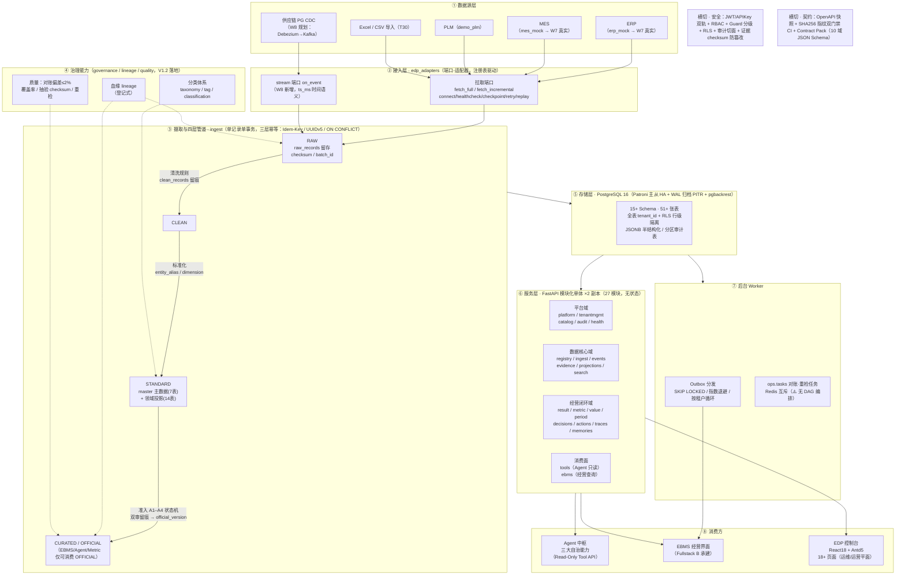
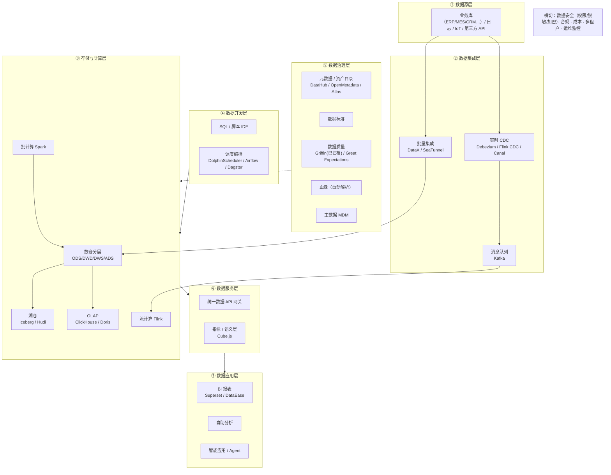

# EDP 架构对标标准数据中台（现状盘点 + 差距分析）

> 基线：代码盘点 2026-10-16（迁移 0001–0017，含 V1.2 治理栈 / 事实层 / 指标价值层 / 对象标签）；
> 参照：`EDP数据平台系统设计文档_V2.0.md`、`docs/AEOS_..._总体方案_V1.2/V1.3`、`docs/V1.2_四层模型映射表.md`。

---

## 一、EDP 当前架构（As-Is）

**一句话定位**：EDP 是**面向 AEOS 决策闭环的"数据与证据底座"**——只存"对象注册 / 事件 / 证据 / 决策 / 行动 / 结果 / 指标 / 血缘"，不复制源业务库；以四层模型（RAW→CLEAN→STANDARD→CURATED）+ 准入状态机保证"进入企业事实层的数据全部可追溯、可审计"。

---

## 二、标准数据中台参考架构（业界通用分层）

---

## 三、逐层对标分析

图例：✅ 已建 · 🟡 部分/规划 · ❌ 缺失 · ⛔ 有意不做（冻结条款，见 V1.2 §11 / V1.3 §一）

| 标准中台能力 | EDP 现状（2026-10-16） | 成熟度 | 对标开源 | 差距与说明 |
|---|---|---|---|---|
| **② 批量数据集成** | 拉取端口（full/incremental）+ 水位推进 + reconcile 三计数 + 三层幂等；适配器仅 erp_mock/mes_mock/demo_plm | 🟡 | DataX、SeaTunnel | 机制完备但**连接器生态为零**（真实 Connector 排在 W7：T28/T29）；SeaTunnel 有 300+ 连接器可参考 |
| **② 实时 CDC** | W8 规划：Debezium(pgoutput) + Kafka（仅 CDC 专用 topic）+ stream 端口 + DLQ + 双轨对账 | 🟡 规划中 | Debezium + Kafka | 技术选型与业界主流一致；冻结"不得蔓延至 Flink/通用消息总线" |
| **③ 数仓分层** | RAW→CLEAN→STANDARD→CURATED 四层 + official_version 指针 + RAW 不可覆盖 | ✅（单库轻量版） | ODS/DWD/DWS/ADS | 治理理念对齐业界方法论；差异是用**单 PostgreSQL** 而非大数据栈实现 |
| **③ 海量存储/计算** | PG16 单库（JSONB / 分区 / RLS）；无湖仓、无 OLAP 引擎、无批/流计算集群 | ⛔ 冻结 | Iceberg、Doris、Flink | 轻版明确不引入 Lakehouse/K8s/Flink；适合当前数据量，属于**有意的架构决策**而非欠债 |
| **④ 任务调度编排** | worker 仅 Outbox 分发；ops.tasks 任务轨道 + Redis 互斥；**无 DAG 编排、无定时摄取调度** | ❌（V1.2 §13.3 已识别缺口） | DolphinScheduler、Airflow、Dagster | 标准中台核心组件之一；EDP 当前靠"任务轨道"轻量替代，多依赖 DAG 场景会受限 |
| **⑤ 元数据/资产目录** | registry（business_objects 组合键/revision）+ catalog（systems/capabilities/skills）+ search + object_tags | 🟡 | DataHub、OpenMetadata | 面向**业务对象**的登记式目录，非自动采集的表/列级技术元数据 |
| **⑤ 数据血缘** | lineage 模块 + governance.lineage 表（schema 契约冻结） | 🟡 | DataHub、Atlas、OpenLineage | **登记式血缘**（管道写入时记录），不做 SQL 自动解析；对闭环追溯已够用 |
| **⑤ 数据质量** | 对账（偏差≤2%）/ 覆盖率 / 抽验 checksum / 重检任务；V1.2 规划六维 DQ | 🟡 | Griffin（已归档）、Great Expectations | 自建且与 ops.tasks/准入联动，是**质量→准入→消费**一体的特色做法 |
| **⑤ 数据标准/主数据** | standardization（entity_alias/dimension）+ master 7 表主数据投影；entity_resolution 待建 | 🟡 | 重型 MDM（⛔ 冻结不引入） | 轻量主数据路线；MDM 深度能力（ golden record 合并等）不做 |
| **⑤ 数据资产审核/准入** | admission A1–A4（15 态）状态机 + 双审留痕 + 归档 | ✅ 特色强项 | **开源无直接对标** | 业界开源中台基本没有"数据准入门禁"能力，是 EDP 差异化 |
| **⑥ 指标/语义服务** | Metric Registry（定义快照/版本/definition_owner）+ Value Ledger + Period Service；口径裁决归 M01 Kernel | ✅ | Cube.js、Headless BI | 边界清晰："规则归 Kernel，事实归 EDP"，杜绝第二套口径 |
| **⑥ 数据 API 服务** | tools（Agent Read-Only，scope=readonly）+ ebms 查询 + OpenAPI 契约双门禁 | ✅（定向供给） | 数据 API 网关 | 非通用自助取数 API，是**受控供给**（对齐 AI 越权缓解） |
| **⑦ BI/可视化** | EDP 控制台（运维平面）；明确不为 EBMS 做经营驾驶舱 | ⛔ 有意克制 | Superset、DataEase | 自助分析/报表不在第一阶段范围 |
| **横切·数据安全** | JWT/APIKey 双轨 + RBAC + Guard（Human-Only/Read-Only/AutoAllowed）+ RLS + 审计切面 + checksum 防篡改 + 越权=0 验收 | ✅ 强项 | Apache Ranger | 证据防篡改与 100% 逆向追溯为标准中台所不具备 |
| **横切·多租户/运营** | tenant_id 全表 + RLS + 配额 + 限流 + 租户生命周期 + shared/dedicated 双形态 | ✅ 强项 | 开源中台普遍缺失 | SaaS 化基础好 |
| **横切·高可用/运维** | Patroni 主从 HA + PITR + pgbackrest + 演练手册 + health + 租户级恢复 | ✅（PG 栈完整） | — | 覆盖 PG 体系；多组件栈（Kafka/Debezium）运维随 W8 新增 |
| **横切·契约工程** | OpenAPI 快照 + SHA256 指纹门禁 + Contract Pack（10 域 JSON Schema）进 CI | ✅ 强项 | 开源中台普遍缺失 | 契约驱动的前后端/Agent 协作模式 |

### 成熟度汇总

| 状态 | 数量 | 能力项 |
|---|---|---|
| ✅ 已建（含强项） | 7 | 数仓分层、准入审核、指标服务、数据 API、安全、多租户、HA/契约 |
| 🟡 部分/规划 | 6 | 批量集成、实时 CDC、元数据目录、血缘、质量、主数据 |
| ❌ 缺口 | 1 | 任务调度编排（DAG） |
| ⛔ 有意不做 | 2 | 大数据栈（湖仓/OLAP/流计算）、自助 BI |

---

## 四、总体结论

1. **定位差异**：EDP 不是通用数据中台，而是**"证据与事实平台"**——服务 AEOS"识别→决策→审批→执行→验证"闭环，验收标准是"Result→Exception→Decision→Evidence→源数据 100% 可逆向追溯"，这决定了它的能力取舍。
2. **方法论对齐**：四层模型、准入门禁、登记式血缘、指标口径Owner分离——治理方法论与业界数据中台（含阿里 OneData 体系）高度同源，甚至更严格（RAW 不可覆盖、OFFICIAL 才可消费）。
3. **工程路线差异**：业界中台=大数据组件栈组合（SeaTunnel+Flink+Doris+DataHub+DolphinScheduler+Superset）；EDP=**单 PostgreSQL + 模块化单体自研**，以冻结条款控制复杂度。当前数据量与企业规模下是合理决策；若未来数据量/租户数上量，存储计算层是第一个需要重开的冻结项。
4. **真实差距（按优先级）**：
   - **连接器生态**（W7 已排期：ERP/MES 真实 Connector）——当前全部 mock，是最大交付风险；
   - **任务调度编排**（缺口，V1.2 已识别）——若引入，业界首选 DolphinScheduler，轻量可评估 APScheduler/Celery beat 扩展现有 ops.tasks；
   - **实时链路**（W8 已排期：Debezium+Kafka）——选型与业界一致；
   - 平台级元数据自动采集/SQL 血缘解析——当前登记式够用，若做多租户对外 SaaS 需评估 DataHub 类能力。

---

## 五、可选：对标开源补缺建议

| 缺口 | 轻版方案（与冻结条款兼容） | 重版方案（需解冻裁决） |
|---|---|---|
| 调度编排 | 扩展 ops.tasks + APScheduler/Celery beat + 现有 Redis 互斥 | DolphinScheduler / Airflow |
| 连接器 | 按统一端口自研（现有 7 方法接口）；参考 SeaTunnel connector 实现 | 直接部署 SeaTunnel 做集成层 |
| CDC | V1.3 已定：Debezium + Kafka（专用） | + Flink CDC 流处理 |
| 元数据/血缘 | 维持登记式 lineage + search | DataHub / OpenMetadata 对接 |
| BI | 维持"EBMS 消费面只读查询"边界 | Superset / DataEase（租户自服务） |
| 分析负载 | PG 分区 + 只读副本 + 物化视图 | Doris / ClickHouse / Iceberg |

> 结论：**EDP 与标准数据中台不是同构竞争关系，而是"决策证据底座 ⊂ 数据中台"的子集 + 治理增强**；按 V1.3 路线补齐连接器与实时链路后，即具备轻量级数据中台的完整主链路。
